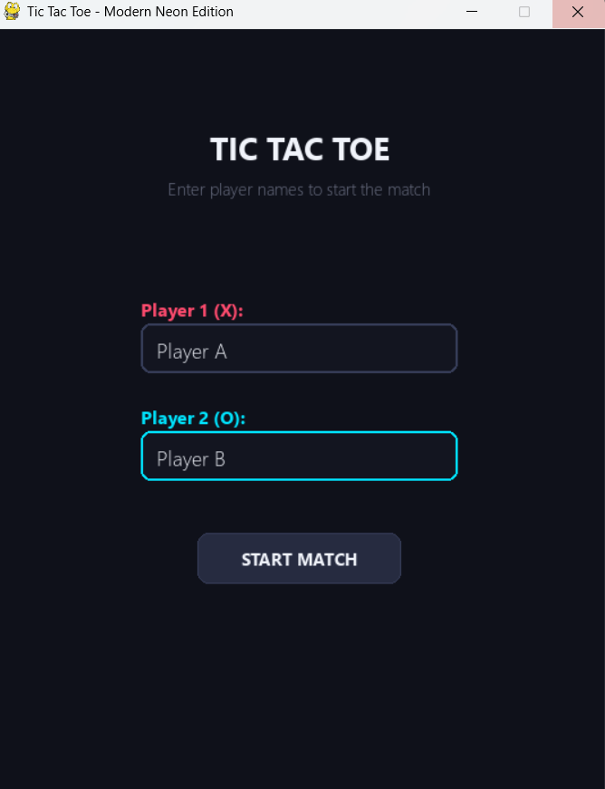
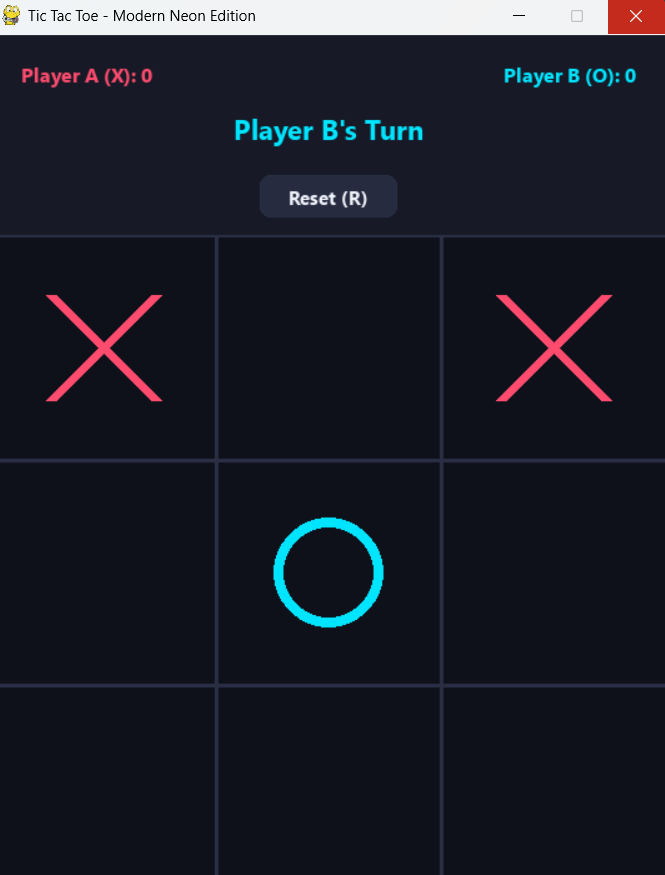

# Tic-Tac-Toe (Doz)

I created a two-player Tic-Tac-Toe game using Python and Pygame. I let you choose your names then you take turns placing Xs and Os. I show you who gets three Tic-Tac-Toe marks in a row. I also keep a score record between rounds.

## Features

- I let you enter a name for each player before the game starts.

- I let you play with two players on the computer.

- I show you whose turn it is and I keep track of scores.

- I highlight the winning Tic-Tac-Toe combination.

- I let you start a round by clicking the, on-screen button or by pressing `R`.

- I let you use the arrow keys `Tab` or `Enter` to move between the name fields.

## Run the game

I need Python installed on your computer. I ask you to install Pygame with:

```bash
pip install pygame
```
## Screenshots

<p align="center">
  
  <br>
  <em>Start Menu & Name Input</em>
</p>

<p align="center">
  
  <br>
  <em>Interactive Neon Gameplay</em>
</p>

<p align="center">
  
  <br>
  <em>Winner Announcement</em>
</p>
